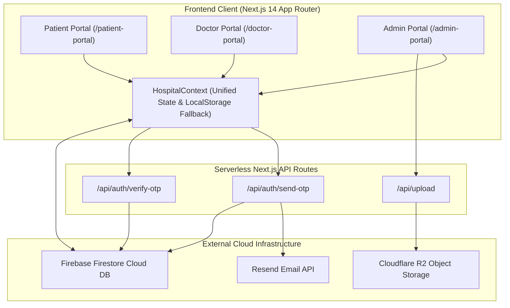

# InspireZest Multispeciality Healthcare System
### Enterprise Hospital Administration & Clinical Management Platform

[](https://nextjs.org/)
[](https://react.dev/)
[](https://www.typescriptlang.org/)
[](https://tailwindcss.com/)
[](https://www.cloudflare.com/products/r2/)
[](https://firebase.google.com/)
[](https://resend.com/)

---

## 🌟 Overview

**InspireZest Multispeciality Healthcare System** is a full-stack, enterprise-grade hospital administration platform designed to connect Patients, Doctors, and Administrators into one clinical ecosystem. 

Modeled after modern healthcare benchmarks (including Meditrina Healthcare styling), the platform incorporates high-impact visual design, full-bleed mega menus, smooth Framer Motion micro-interactions, dynamic video/image hero media, Resend-powered passwordless OTP authorization, and Cloudflare R2 object storage.

---

## 🏛️ Tripartite Portal Architecture

```
+-------------------------------------------------------------------------+
|                  INSPIREZEST HEALTHCARE ECOSYSTEM                       |
+--------------------+---------------------+------------------------------+
|   PATIENT PORTAL   |    DOCTOR PORTAL    |         ADMIN PORTAL         |
|  - Doctor Search   |  - Clinical Queue   |  - Executive Analytics       |
|  - Slot Booking    |  - Availability     |  - Doctor & Patient CRUD     |
|  - Resend OTP Auth |  - e-Prescriptions  |  - Hero Video / Image Toggle |
|  - Prescription Rx |  - Profile & Bio    |  - Cloudflare R2 Uploads     |
+--------------------+---------------------+------------------------------+
```

### 1. 🏥 Patient Portal (`/patient-portal`)
- **Doctor Directory & Filtering**: Search across 22 medical specialities, filtering by experience, rating, and fee.
- **Real-Time Appointment Booking**: Interactive calendar slot selection with immediate confirmation.
- **Passwordless Resend OTP Authorization**: Secure 6-digit email OTP delivery via the Resend API.
- **Digital Prescription Hub**: View, download, and review issued medical prescriptions and follow-up consultation dates.
- **Meditrina Mega Menus**: Full-bleed expandable navigation drawers for *Our Hospitals*, *Specialities*, *About*, and *Resources*.
- **Dynamic Media Hero**: Seamless live switching between cinematic video background and curated image carousel.

### 2. 🩺 Doctor Portal (`/doctor-portal`)
- **Outpatient Consultation Queue**: Real-time triage of pending and confirmed appointments.
- **Interactive Availability Calendar**: Toggle active practice dates and schedule daily consultation slots.
- **Digital e-Prescriptions Creator**: Multi-row medication table with drug name, dosage, frequency, duration, instructions, and follow-up date.
- **Physician Profile Configuration**: Bio, consulting room, fees, and contact details management.

### 3. ⚙️ Admin Portal (`/admin-portal`)
- **Executive Operations Dashboard**: Total revenue, patient registrations, active doctors, and visit metrics.
- **Doctor & Patient Master CRUD**: Complete clinical registries with photo uploads via Cloudflare R2.
- **Hero Media Settings Manager**: Switch between video and image banner modes, configure overlay opacity, and upload MP4 videos directly to Cloudflare R2.
- **Specializations & Blog CMS**: Create medical news, healthcare breakthrough articles, and department descriptions.

---

## 📊 System Architecture Diagram



---

## 🛠️ Tech Stack & Key Libraries

| Layer | Tools / Libraries |
| :--- | :--- |
| **Framework** | Next.js 14 (App Router), React 18, TypeScript |
| **UI & Styling** | Tailwind CSS, Lucide React, React Bits BlurText |
| **Animations** | `motion/react` (Framer Motion v14) |
| **Cloud Storage** | Cloudflare R2 via `@aws-sdk/client-s3` |
| **Database** | Firebase Firestore NoSQL Database |
| **Email Verification** | Resend API for Transactional OTP Delivery |
| **Date & Calendar** | `date-fns` |

---

## 🔑 Environment Variables

Create a `.env.local` file in the root directory:

```env
# Resend API for Email OTP
RESEND_API_KEY="re_xxxxxxxxxxxxxxxxxxxxxxxxxxxxxxxxx"
RESEND_FROM_EMAIL="InspireZest Hospitals <onboarding@resend.dev>"

# Cloudflare R2 S3 Object Storage
CLOUDFLARE_R2_ACCOUNT_ID="your_cloudflare_account_id"
CLOUDFLARE_R2_ACCESS_KEY_ID="your_cloudflare_access_key_id"
CLOUDFLARE_R2_SECRET_ACCESS_KEY="your_cloudflare_secret_access_key"
CLOUDFLARE_R2_BUCKET="hospitaladministration"
NEXT_PUBLIC_R2_PUBLIC_URL="https://pub-f6697a3e2acd4048a86b5ed54d969979.r2.dev"

# Firebase Firestore Configuration
NEXT_PUBLIC_FIREBASE_API_KEY="your_firebase_api_key"
NEXT_PUBLIC_FIREBASE_AUTH_DOMAIN="hospitaladministration-41b48.firebaseapp.com"
NEXT_PUBLIC_FIREBASE_PROJECT_ID="hospitaladministration-41b48"
NEXT_PUBLIC_FIREBASE_STORAGE_BUCKET="hospitaladministration-41b48.firebasestorage.app"
NEXT_PUBLIC_FIREBASE_MESSAGING_SENDER_ID="546800743524"
NEXT_PUBLIC_FIREBASE_APP_ID="your_firebase_app_id"
NEXT_PUBLIC_FIREBASE_MEASUREMENT_ID="your_measurement_id"
```

---

## 🚀 Quick Start Guide

### 1. Clone & Install
```bash
git clone https://github.com/Thanzeerwork/hospital-administration.git
cd hospital-administration
npm install
```

### 2. Run Locally
```bash
npm run dev
```
Open [http://localhost:3000](http://localhost:3000) in your browser.

- **Patient Portal**: `http://localhost:3000/patient-portal`
- **Doctor Portal**: `http://localhost:3000/doctor-portal`
- **Admin Portal**: `http://localhost:3000/admin-portal`

### 3. Production Build
```bash
npm run build
npm run start -p 3000
```

---

## 📁 Project Structure

```
hospital-administration/
├── public/                     # Static assets, SVG vector logos, video files
│   ├── images/                 # Hospital branding, doctor avatars
│   └── videos/hero.mp4         # High-resolution hospital hero video
├── src/
│   ├── app/
│   │   ├── admin-portal/       # Executive metrics, doctors/patients CRUD, hero settings
│   │   ├── doctor-portal/      # Consultation queue, calendar availability, e-prescriptions
│   │   ├── patient-portal/     # Doctor search, slot booking, auth, prescription viewer
│   │   ├── api/
│   │   │   ├── auth/send-otp/  # Resend OTP sender endpoint
│   │   │   ├── auth/verify-otp/# OTP validation endpoint
│   │   │   └── upload/         # Cloudflare R2 S3 multipart upload endpoint
│   │   ├── layout.tsx          # Root layout & providers
│   │   └── page.tsx            # Portal selector landing page
│   ├── components/
│   │   ├── animations/         # Framer Motion reveal wrappers & BlurText
│   │   ├── layout/             # PatientNav, Meditrina mega menus, footers
│   │   └── ui/                 # Modals, buttons, toast notification container
│   ├── context/
│   │   └── HospitalContext.tsx # Unified multi-role state & storage sync
│   ├── lib/
│   │   ├── cloudData.ts        # Cloudflare R2 seed endpoints & clinical datasets
│   │   ├── firebase.ts         # Firestore connection, collections & mutations
│   │   └── r2.ts               # S3Client setup and Cloudflare R2 file uploader
│   └── types/
│       └── index.ts            # Clinical TypeScript data models & schemas
├── README.md                   # Repository overview
└── package.json
```

---

## 📄 License
InspireZest Multispeciality Healthcare System is proprietary clinical software. All rights reserved.
